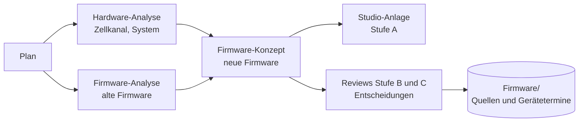

# Dokumentation Batterie-Simulator

Dieser Ordner beschreibt den Batterie-Simulator (14 isolierte Zellkanäle, Master mit S32K146, Steuerung per CAN):
die Analyse der bestehenden Hardware und Firmware, den Plan und das Konzept der neuen Firmware auf neXtBSW sowie die
Reviews und Entscheidungen des Nutzers als Safety Responsible. Die HTML-Seiten waren bis 05.11.2026 zusätzlich als
claude.ai-Artefakte veröffentlicht; seitdem sind die Dateien hier die einzige Quelle (Archivindex unten).

## Planung

| Dokument | Inhalt | Stand |
|---|---|---|
| [plan.html](plan.html) | Arbeitspakete BS-1 bis BS-4 mit Prioritäten: LabControl-Treiber, Gerätetest, Hardware- und Firmware-Analyse, neue Firmware. | 22.10.2026 |

## Hardware

| Dokument | Inhalt | Stand |
|---|---|---|
| [hardware-zellkanal.html](hardware-zellkanal.html) | Analyse des Zellkanals BattSim_V1: Blockschaltbild, Arbeitsweise, Kennwerte, Befunde und Abgleich mit der Fehlerliste des Erstaufbaus (BS-2, Teil 1), mit Nachtrag zum Gerätetest. | 22.10.2026 |
| [hardware-system.html](hardware-system.html) | Rückwand, Master und Versorgung, Sicherheitsbefunde S1–S3 und Pinbelegung S32K146 LQFP-144 (BS-2, Teile 2–4). | 22.10.2026, ergänzt 28.10.2026 (Ruhepegel „aus“ für SET und EN im Reset) |

## Firmware

| Dokument | Inhalt | Stand |
|---|---|---|
| [firmware-analyse.html](firmware-analyse.html) | Analyse der alten Firmware BATTSIM_CONTROL (Simulink): Datenfluss, Zustände, Befunde F1–F10, Anforderungen FW-01…FW-15 (BS-3). | 22.10.2026 |
| [firmware-konzept.html](firmware-konzept.html) | Konzept der neuen Firmware auf neXtBSW: Aufbau, Betriebsarten, Sicherheit, CAN, Kalibrierung, Lücken in neXtBSW, Stufen A–D (BS-4). | Entwurf 22.10.2026, ergänzt 23.10.2026 |
| [studio-anlage.html](studio-anlage.html) | Schritt-für-Schritt-Anleitung, das Firmware-Projekt im neXtBSW Studio anzulegen (Stufe A). | 23.10.2026 |

Die Firmware-Quellen selbst liegen in [`Firmware/`](../Firmware/) dieses Repositorys (siehe unten).

## Gerätetests und Protokolle

| Dokument | Inhalt | Stand |
|---|---|---|
| [can-verhalten.md](can-verhalten.md) | CAN-Verhalten der alten Firmware aus dem Simulink-Modell, mit Abschnitt „Am Gerät geprüft“ (BS-1.0, BS-1.8). | 21.10.2026, am Gerät geprüft 22.10.2026 |
| [geraetetest-uebergabe.md](geraetetest-uebergabe.md) | Übergabe für den ersten Gerätetest BS-1.8: Stand, offene Klärungen, Ablauf. | 22.10.2026 |

Die Protokolle der späteren Gerätetermine (Stufe B bis D) stehen in [`Firmware/doc/`](../Firmware/doc/).

## Reviews und Entscheidungen

Statische Protokolle der Review-Artefakte: Die gewählte Option ist je Punkt markiert, darunter Anmerkung und Zeitpunkt.
Neben jeder Seite liegt `<name>.db.json` mit dem rohen Inhalt der Artefakt-Datenbank. Alle neun Reviews sind
abgeschlossen, kein Punkt ist offen.

| Dokument | Inhalt | Stand |
|---|---|---|
| [reviews/2026-10-28-review-stufe-b.html](reviews/2026-10-28-review-stufe-b.html) | Annahmen der Modelllogik in Stufe B (Abschaltwege, Überlast, Rücksetzen aus FAIL, Tasten, Zellstatus, CI), Punkte B-1 bis B-10. | abgeschlossen 28.10.2026, alle wie empfohlen; Anmerkung zu B-9: „ich baue selbst auf StateFlow um“ |
| [reviews/2026-10-28-reset-eskalation.html](reviews/2026-10-28-reset-eskalation.html) | Safety-Eskalation nach dem Geräteteil von Stufe B: Zelle im Reset des Masters auf etwa 5,25 V (S-1), Abschaltzeit (S-2), Rückweg zur Werksfirmware (S-3). | abgeschlossen 28.10.2026; S-3 abweichend: b (Rückweg prüfen, Werksfirmware bleibt) |
| [reviews/2026-10-28-globale-kalibrierparameter.html](reviews/2026-10-28-globale-kalibrierparameter.html) | neXtBSW-Konzept vor Stufe C: globale Kalibriergrößen, die mehrere Komponenten lesen (G-1 bis G-6). | abgeschlossen 28.10.2026; abweichend G-1 b (Parameter-Komponente nach AUTOSAR) und G-5 b (Konstanten gleich mit) |
| [reviews/2026-10-30-review-stufe-c.html](reviews/2026-10-30-review-stufe-c.html) | Stufe C: Kalibrierung, Regler und Diagnose, Punkte C-1 bis C-7 (ungültige Strommessung, Überspannung je Kanal, Grenzen und Schutz der Kalibrierung, Regler, zweiter Abschaltweg). | abgeschlossen 30.10.2026, alle wie empfohlen |
| [reviews/2026-10-30-review-stufe-c-nachtrag.html](reviews/2026-10-30-review-stufe-c-nachtrag.html) | Nachtrag zu C-2: Vergleich der Überspannung mit dem ungefilterten Abtastwert (C-2a) und Messung der Sprungantwort (C-2b). | abgeschlossen 30.10.2026, alle wie empfohlen |
| [reviews/2026-10-30-review-stufe-c-geraetebefund.html](reviews/2026-10-30-review-stufe-c-geraetebefund.html) | Gerätebefund Stufe C: Pegelboden 0,7 V ohne Last löst C-2 falsch aus (C-2c), Unterschwingen des Reglers (R-1), welche Firmware bleibt (F-1). | abgeschlossen 30.10.2026, alle wie empfohlen |
| [reviews/2026-10-30-review-stufe-c-ergaenzungen.html](reviews/2026-10-30-review-stufe-c-ergaenzungen.html) | Ergänzungen bei der Umsetzung von C-2c: Regler aus unter dem Pegelboden (E-1), Kanalstatus 4 in der DBC (E-2). | abgeschlossen 30.10.2026, alle wie empfohlen |
| [reviews/2026-10-30-review-c1-strommessung.html](reviews/2026-10-30-review-c1-strommessung.html) | C-1 erkennt eine gültige, aber falsche Strommessung nicht: Plausibilitätsprüfung (S-1) und Nachweis am Gerät (S-2). | abgeschlossen 30.10.2026, alle wie empfohlen |
| [reviews/2026-10-30-review-termin-0-3-2.html](reviews/2026-10-30-review-termin-0-3-2.html) | Befunde aus dem Gerätetermin mit Last (Firmware 0.3.2): Pegelboden (T-1), Spannungsabfall bis zur Klemme (T-2), Regler beim Sprung (T-3), Abschaltzeit (T-4). | abgeschlossen 30.10.2026, alle wie empfohlen |

Offene Fragen und neue Freigaben laufen weiter über das Longboard-Entscheidungsboard
(https://claude.ai/artifact/RNwfdpYBfNxwNVDEL7XjS9, Kennung `bs-*`).

## Archiv

| Dokument | Inhalt | Stand |
|---|---|---|
| [archiv/artefakte-2026-11.html](archiv/artefakte-2026-11.html) | Archivindex der claude.ai-Artefakte: Adresse, lokale Datei, gelesene Version, Ergebnis des Abgleichs. | 05.11.2026 |

## Firmware-Ordner `Firmware/`

Quellen der neuen Firmware (neXtBSW-Kundenprojekt `battsim_master`), Sicherheitshinweise und Protokolle der
Gerätetermine liegen in [`Firmware/`](../Firmware/), Ordner `doc/`:

| Datei in `Firmware/` | Inhalt |
|---|---|
| `doc/sicherheitshinweise-stufe-b.md` | Sicherheitshinweise und Bericht zum Geräteteil der Stufe B (Stand 28.10.2026). |
| `doc/messungen-stufe-b/` | Oszilloskop-Bilder zu Reset und Abschaltzeit aus Stufe B. |
| `doc/sicherheitshinweise-stufe-c.md` | Sicherheitshinweise der Stufe C (Kalibrierung, Regler, Diagnose). |
| `doc/stufe-c-kalibrierung-regler.md` | Beschreibung von Kalibrierung, Regler und Diagnose der Stufe C. |
| `doc/messungen-kalibrierung-fluke-2026-10-31.md` | Prüfung und Kalibrierung mit dem Fluke 175 (31.10.2026, Firmware 0.3.4). |
| `doc/geraetetermin-can-update-2026-11-01.md` | Gerätetermin 01.11.2026: Firmware 0.4.0 erstmals über CAN geladen. |
| `doc/stufe-d-handbetrieb-anzeige.md` | Stufe D, Teil 1: Handbetrieb und Anzeige. |
| `doc/geraetetermin-handbetrieb-2026-11-04.md` | Gerätetermin 04.11.2026: Firmware 0.5.0 (Handbetrieb), Drehgeber, Anzeige. |
| `doc/geraetetermin-anzeige-2026-11-04.md` | Gerätetermin 04.11.2026 abends: Anzeige mit Pull-up an SCL, Firmware 0.5.1. |
| `doc/nextbsw-updates/` | Änderungsnotizen zu den neXtBSW-Ständen, auf die das Projekt jeweils angehoben wurde. |
