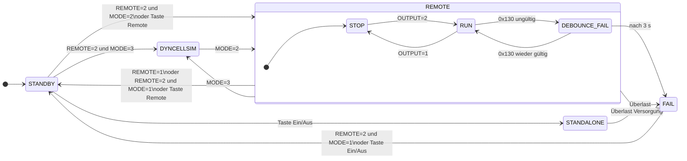
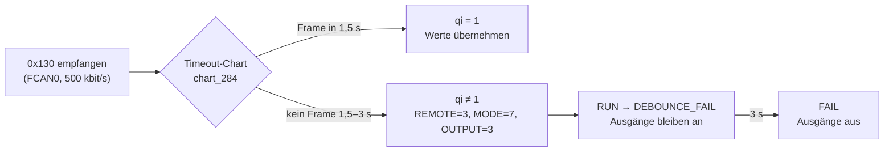

# CAN-Verhalten der bestehenden Firmware (BS-1.0)

Grundlage: `BATTSIM_CONTROL.slx` (Stand im Quellordner, gelesen 2026-10-21 mit `tools/slx_dump.py`),
`parameter.m`, `BattSimV1.dbc`. Alle Aussagen stammen aus dem Modell (Block-SID bzw. Chart in Klammern).
**Am Gerät geprüft am 22.10.2026 (BS-1.8, Abschnitt „Am Gerät geprüft“ am Ende):** Betriebsarten, Zellfreigabe,
Zellstatus, Ausfall von 0x130 und Zurücksetzen aus FAIL stimmen mit dem Modell überein; Abweichungen und neue
Befunde stehen im letzten Abschnitt.

## Betriebsarten (Chart `CONTROL_TASK/ControlStateMachine`, chart_318)

| Zustand | `BATTSIM_STATUS` (0x120) | PWM (Stellglieder) | Zellen |
|---|---|---|---|
| STANDBY | 1 | aus | alle aus (gebrückt) |
| STANDALONE | 2 | ein | per Taste |
| REMOTE / STOP | 3 | aus | alle aus |
| REMOTE / RUN | 3 | ein | Zelle n ein, wenn `CELLn_ENABLE` ≠ 0 |
| DYNCELLSIM | 4 | wie REMOTE | wie REMOTE |
| FAIL | 5 | aus | alle aus, Fehler-LED blinkt 0,2 s |

`BATTSIM_OUTPUT_STATUS` (0x120) = 2 bei PWM ein, sonst 1 (`CAN_TX_TASK/CreateOutputStatus`, 2189).
Eine abgeschaltete Zelle ist am Ausgang gebrückt (0 V), der Stapel bleibt geschlossen (Konzept.pptx).

## Steuerbotschaft 0x130 und Ausfall

- **Timeout** (chart_284, `can_comm.id130h_timeout = 3`): Ein Merker wird bei jedem Empfang gesetzt und alle 1,5 s
  zurückgesetzt. Fehlt der Frame 1,5–3 s, ist die Botschaft ungültig.
- **Ungültig** heißt: `EvalRemoteControl` (2233), `EvalModeControl` (2438) und `EvalRemoteOutputControl` (1926)
  ersetzen die Werte durch 3 / 7 / 3. Damit greift kein Übergang außer `RUN → DEBOUNCE_FAIL`; in STOP passiert nichts.
- **Folge in RUN**: nach weiteren 3 s FAIL (`DEBOUNCE_FAIL` hat keine Entry-Aktion, die PWM bleibt bis dahin an).
  Ausgänge sind also **4,5–6 s** nach dem letzten 0x130 aus.
- **Aus FAIL heraus** per CAN: `REMOTE=2, MODE=1` (→ STANDBY), danach `MODE=2` (→ REMOTE/STOP), dann `OUTPUT=2`.
  Das gilt nicht nach einer **Überlast** der 48-V-Versorgung (> 1,28 A): Sie ist in einem SR-Flipflop gespeichert,
  das nur die Taste ALL ON/OFF bei Strom unter 1,08 A zurücksetzt, und sie sperrt den Wechsel STANDBY → REMOTE
  (Firmware-Analyse F5).

## Zellbotschaften 0x100–0x105

- Gültigkeit je Botschaft wie oben (Timeout 3 s). **Fällt eine aus, gelten die letzten gültigen Werte weiter**
  (Unit-Delay-Halteglied in `CheckSignalQualifier`, 2908 und 3410). Kein Übergang nach FAIL.
- Sollwert → PWM über die Tabelle `VoltageSetValue_Ax`/`VoltageSetPwm_T` (0–5 V, darüber begrenzt durch
  `UseLastTableValue`).
- **Freigabe**: `CELLn_ENABLE` wird als uint8 gespeichert und vor dem Zustandsautomaten **nach boolean gewandelt**
  (Cast 3483 in 3410). 0 = aus, **1 und 2 = ein**. Die DBC sagt 1 = „disable“ – das wirkt bei dieser Firmware als
  Freigabe. *Am Gerät prüfen.*
- Kanäle 15 und 16 sind im Zustandsautomaten auskommentiert (`Enable15`/`Enable16`); wirksam sind 14 Kanäle.

## Rückmeldungen (alle 100 ms, `CAN_TX_TASK`, 190)

| ID | Inhalt | Besonderheit |
|---|---|---|
| 0x110–0x115 | Istspannung Zelle 1–16, auf mV gerundet (`RoundToMillivolts`, 3535) | Zellen 15/16 ohne Bedeutung |
| 0x110–0x115 | `CELLn_STATUS` = `EnableArray(n)` | **1 = aus, 0 = ein**; die DBC erwartet 2 = „enabled“ |
| 0x120 | `BATTSIM_STATUS`, `BATTSIM_OUTPUT_STATUS` | siehe Tabelle oben |

Alle Sendebotschaften tragen denselben Alive-Zähler (`AliveGenerator`, 1561).

## Alive- und Zykluszeit-Prüfung (`IntegrityCheckMsgId*`)

- Alive: ab Zählerstand 2 muss der Zähler um genau 1 steigen; bei 0 und 1 bleibt das letzte Ergebnis stehen
  (Überlauf 15 → 0 wird so toleriert).
- Zykluszeit: `(Δt < 1,5·Zyklus) ODER (0,5·Zyklus < Δt)` – das ist immer wahr. Weil das Ergebnis mit der
  Alive-Prüfung ODER-verknüpft wird, ist **die Alive-Prüfung praktisch wirkungslos**. Für den Ausfall zählt nur der
  Timeout.

## Folgen für den LabControl-Treiber

| Thema | Umsetzung |
|---|---|
| Takt | 0x130 alle 100 ms, 0x100–0x105 alle 1000 ms, jeweils sofort zusätzlich bei Änderung; Alive je Botschaft +1 (mod 16), auch wenn die Firmware ihn kaum prüft |
| Online | Gerät gilt als verbunden, solange 0x120 kommt (Zyklus 100 ms, offline nach 1 s) |
| Remote ein | `REMOTE=2, MODE=2, OUTPUT=1` → REMOTE/STOP |
| Ausgang ein / aus | `OUTPUT=2` / `OUTPUT=1` |
| Remote aus | `REMOTE=1` → STANDBY |
| Zelle aus | `CELLn_ENABLE=0` (wirkt bei alter und neuer Firmware), Zelle ein `=2` |
| Zellstatus lesen | 1 = aus, 0 oder 2 = ein, 3 = Sollwertfehler |
| „Alles aus“ | `OUTPUT=1`, weiter zyklisch senden |
| LabControl beendet sich geordnet | `OUTPUT=1`, dann `REMOTE=1`, danach Senden einstellen |
| LabControl stürzt ab | Simulator schaltet nach 4,5–6 s über FAIL ab |
| FAIL erkannt | in der Kachel anzeigen; „Zurücksetzen“ = `MODE=1`, dann `MODE=2` |
| Kanalzahl | 14 (bestückt), DBC-Signale 15/16 werden nicht angeboten |

## Für die neue Firmware (Aufgabe 4) vorgemerkt

1. Freigabe: 0 und 1 = aus, 2 = ein, 3 = ungültig (DBC einhalten, alter Treiberwert 0 bleibt gültig).
2. Zellstatus nach DBC senden (2 = ein).
3. Zykluszeitprüfung mit UND statt ODER, Alive-Prüfung wirksam machen.
4. Bei ungültigem 0x130 in RUN die Ausgänge sofort sperren statt 3 s nachzulaufen (oder die Entprellzeit bewusst festlegen).

## Am Gerät geprüft (BS-1.8, 22.10.2026)

Aufbau: LabControl 0.22.0 (`check_battsim.py`, danach die App und MCP), CANcaseXL Kanal 2 (`vector:59177:1`, 500 kbit/s),
Zellabgriff J19 unbelegt, Multimeter an einzelnen Zellen. Die Rückmeldung wurde mit dem Multimeter verglichen, nicht
nur gelesen. Gerät: Master mit **Nacharbeit** (siehe Abschnitt „Aufbau wie gebaut“ in `hardware-system.html`).

| Thema | Modell | Am Gerät | Ergebnis |
|---|---|---|---|
| Online / Status | 0x120 alle 100 ms, Zustand Standby | 0x120 kommt, Standby, 14 Zellen „aus“ | bestätigt |
| Remote ein, Sollwert, Ausgang ein | REMOTE/STOP → RUN, Zelle ein bei `CELLn_ENABLE` = 2 | alle 14 Zellen folgen innerhalb 0,5 s | bestätigt |
| Zelle aus (`CELLn_ENABLE` = 0) | Zelle gebrückt, Status 1 | Zelle 5 auf ≈ 0,03 V (Multimeter 0,028 V), Status „aus“ | bestätigt |
| Zellstatus roh | 1 = aus, 0 = ein | genau so; Kanal 15/16 melden immer 1 | bestätigt |
| Ausfall von 0x130 in RUN | FAIL nach 4,5–6 s, Ausgänge dann aus | **FAIL nach 5,16 s**, alle Zellen < 1 V nach 5,36 s | bestätigt |
| Zurücksetzen aus FAIL | `MODE=1`, dann `MODE=2` | danach REMOTE, Ausgang aus | bestätigt |
| Fernsteuerung über die Taste ohne je ein 0x130 | in STOP passiert nichts | **11 s in „Fernsteuerung“, kein FAIL** | bestätigt (FAIL gibt es nur aus RUN) |
| Taste Output Enable | STANDBY → STANDALONE, alle Kanäle ein | Zustand „Handbetrieb“ (2), 14 Zellen ein; zweiter Druck → Standby | bestätigt |
| Taste Remote Control | STANDBY → REMOTE | Zustand „Fernsteuerung“ (3); zweiter Druck → Standby | bestätigt |
| Freigabewert 1 = ein | wirkt als „ein“ (nicht gesendet) | nicht geprüft, der Treiber sendet 0 und 2 | offen |

### Abweichungen und neue Befunde

1. **Istwert und Ausgang weichen je Kanal ab (B4/B5 der Zellkanal-Analyse).** Sollwert 3,7 V, Multimeter und Meldung:

   | Zelle | Multimeter | Meldung | Ausgang − Soll | Meldung − Multimeter |
   |---|---|---|---|---|
   | 2 | 3,685 V | 3,669 V | −15 mV | −16 mV |
   | 5 | ≈ 3,700 V | 3,712 V | ≈ 0 | +12 mV |
   | 10 | 3,735 V | 3,773 V | +35 mV | +38 mV |
   | 13 | ≈ 3,740 V | 3,813 V | +40 mV | +73 mV |

   Zelle 13 zusätzlich bei 3,0 V (Multimeter 3,022 V, Meldung 3,088 V) und 4,0 V (4,045 V, 4,117 V): ein fester
   Offset der Meldung von ≈ +70 mV (Standby 0,064 V bei 0 V) und ≈ 2 % Verstärkungsfehler am Ausgang. **Folge:** Der
   Istwert vom Gerät taugt nur auf etwa ±0,1 V; für Genauigkeit am Prüfling ein Multimeter verwenden.
   Standby-Restwerte der abgeschalteten Zellen: 0,016–0,07 V.
2. **Handbetrieb startet mit dem zuletzt gesetzten Sollwert.** Nach einer Fernsteuer-Sitzung mit 3,7 V lagen beim Druck
   auf Output Enable alle 14 Zellen sofort auf 3,695 V (Modell: Speicher startet mit 0,5 V, F8). Mit Prüfling am
   Zellabgriff liegt dann sofort diese Spannung an.
3. **Einmal blieb Zelle 5 nach „Alle Zellen ein“ aus** (zweiter Lauf von `check_battsim.py` nach „Zelle 5 aus“ im Lauf
   davor). Nicht reproduzierbar, in drei weiteren Läufen kamen alle 14 Zellen. Ursache offen.
4. **Zelle 1 und 5 zeigten 5,13 V im Standby**, solange die erste Fernsteuer-Sitzung nach dem Einschalten des Geräts
   noch nicht stattgefunden hatte; danach nicht mehr (0,02–0,07 V). Ursache offen.
5. **Reset und Einschalten am Zellabgriff** (Oszilloskop, Zelle 1, ohne Prüfling, Tastkopf 10:1):
   RESET an der Front der Supply-Platine (5-V-Regler aus): ≈ 5,3–5,4 V für ≈ 40 ms, danach ein zweiter Puls bis 1,9 V für
   ≈ 20 ms bei +200 ms. Netzschalter aus/ein: bis 2,3 V für ≈ 40 ms, dann ≈ 0,7 V bis ≈ 80 ms, danach ≈ 0 V.
   Ursache und Folgen: `hardware-zellkanal.html` (S2, ISO6742**F**).
6. **LabControl-App:** Der Zähler „Empfangen“ der CAN-Kachel springt alle ≈ 1,3 s um 32 (Poll-Zyklus langsam), siehe
   LabControl `BUGS_OFFEN.md` #38. Das Kachelfeld „Fernsteuerung“ zeigt die Anforderung des Treibers, nicht den Zustand
   am Gerät (bei Fernsteuerung über die Taste bleibt es 0, der Zustand steht im Feld „Zustand“).

7. **Kartentausch Kanal 13 ↔ 5 (22.10., nach dem Zusammenbau):** Der Offset der Rückmeldung folgt der **Karte**. Standby: Zelle 13 jetzt 0,037 V
   (vorher 0,064 V), Zelle 5 jetzt 0,079 V (vorher 0,03 V). Bei 3,7 V meldet die Karte von Kanal 13 im Steckplatz 5 jetzt 3,797 V
   (vorher 3,813 V im Steckplatz 13), die Karte von Kanal 5 im Steckplatz 13 meldet 3,722 V (vorher 3,712 V). Der Unterschied
   zwischen den Karten beträgt ≈ 85–91 mV, der Einfluss des Steckplatzes/ADC-Kanals ≈ 13 mV. Der Fehler liegt also auf der
   Karte (AMC1311, U11 oder Teiler), nicht in der Rückwand oder im Master. Nicht geprüft: ob der Ausgangsfehler (+40 mV) ebenfalls
   mit der Karte wandert (Multimeter nach dem Tausch).

### Für die neue Firmware zusätzlich vorgemerkt

5. Beim Start und nach Standby die Sollwerte auf 0 V setzen (Handbetrieb und Fernsteuerung), nicht auf den letzten Wert.
6. Die Pin-Belegung der Tasten und von LIMIT entspricht **nicht** dem Master-Schaltplan (Nacharbeit, bestellte
   Leiterplatte): Output Enable → PTD11, Remote Control → PTD12 (aus dem Verhalten abgeleitet), LIMIT über R26 auf
   PTE25, PTD10 ohne Bahn.
