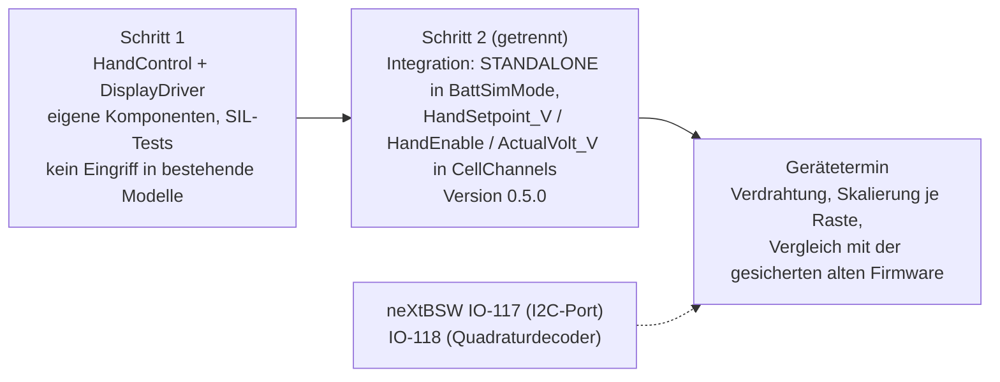
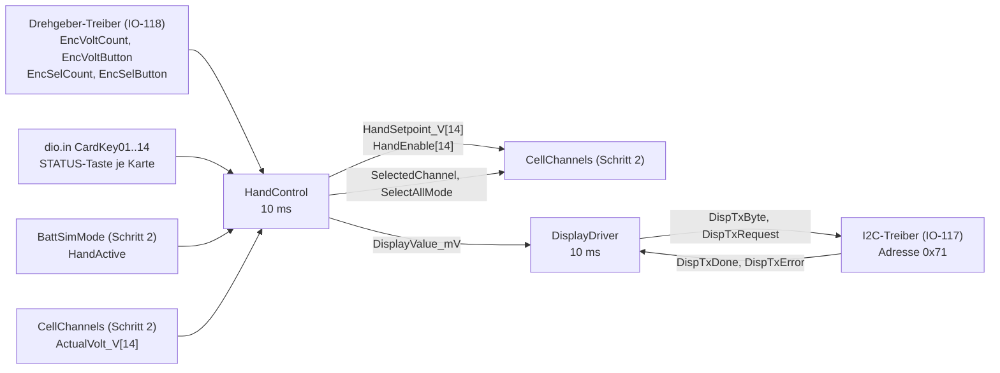
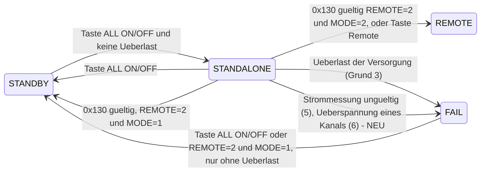
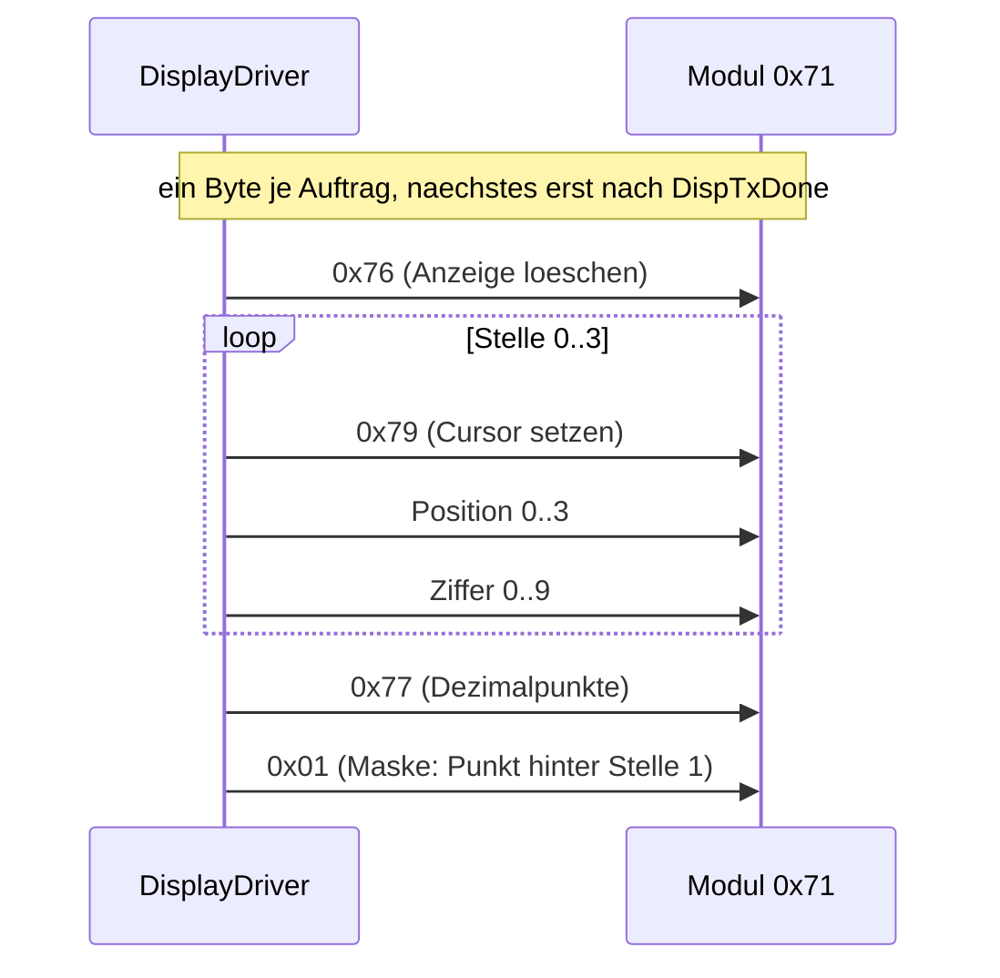

# Stufe D (Teil 1): Handbetrieb und Anzeige (battsim_master)

Stand: 03.11.2026, Zweig `pin-io117` (Treiber angeschlossen). Board `bs-handbetrieb-anzeige` a (P1 bis P6 je a): Handbetrieb und Anzeige kommen vor C-7, XCP und BCU-Tests;
der Handbetrieb startet mit 0 V (F8), wählbar sind nur die konfigurierten Kanäle 1..14 (F9), im Alle-Kanäle-Modus gilt ein Sollwert für alle,
die Verdrahtung von Drehgebern, Anzeige und Karten-Tasten wird im Gerätetermin geprüft. Das Zellmodell (Status 4) gehört **nicht** zu diesem Teil.
Grundlage des alten Verhaltens: `BATTSIM_CONTROL.slx` (Dump `tools/slx_dump.py`, Zustandsautomat `ControlStateMachine`, `INPUT/*Encoder*`,
`DISPLAY_TASK`), `parameter.m`, Firmware-Analyse und `can-verhalten.md` im Workspace BatterieSimulator. Alles, was nicht aus dem Modell stammt, ist als **Annahme** gekennzeichnet.

## 0. Stand

* **Schritt 1 fertig (02.11.2026):** `HandControl` und `DisplayDriver` als Simulink-Komponenten (`swc/HandControl`, `swc/DisplayDriver`, erzeugt von `tools/gen_swc_ports.py` und
  `<Swc>_create.m`), in `rte.yaml` eingetragen, Eingänge der Treiber an `rte.init`. SIL-Test `battsim-sil-hand` (`handdisplay_sil_test.c`): 299 Prüfungen, 0 Fehler;
  `battsim-sil` unverändert 980 Prüfungen, 0 Fehler; Workspace-Tests 9 von 9, 1503 Testfälle; Build warnungsfrei (text 220124 Byte, vorher 214116).
  Bis Schritt 2 sind die Komponenten im Abbild enthalten, aber wirkungslos (kein Handbetrieb aktiv, keine Verbindung zu CellChannels und zu den Treibern).
* **Schritt 2 fertig (03.11.2026), Firmware 0.5.0:** Board `bs-standalone-schutz` a: FAIL 5 (Strommessung ungültig) und FAIL 6 (Überspannung) greifen auch in STANDALONE.
  `BattSimMode` hat den Zustand STANDALONE (intern 4, `BATTSIM_STATUS` 2, `BATTSIM_OUTPUT_STATUS` 2, `OutputEnable` an) und den neuen Ausgang `HandActive`.
  `CellChannels` nimmt bei `HandActive` Sollwert und Freigabe je Kanal aus `HandSetpoint_V` / `HandEnable` (statt aus den CAN-Botschaften), schaltet die SELECT-LEDs
  (`Sel01..14`, nur im Handbetrieb: einzeln der gewählte Kanal, im Alle-Modus alle) und gibt die Istwerte als `ActualVolt_V` an `HandControl`.
  `HandControl` bekommt `HandActive` und `ActualVolt_V` jetzt aus den Komponenten; die Treiber-Eingänge (Drehgeber, Karten-Tasten, I2C-Rückmeldung) bleiben an `rte.init`.
  Fernsteuer-Pfade unverändert (bestehende Prüfungen von `battsim-sil` unverändert grün). `battsim-sil`: 1042 Prüfungen, 0 Fehler (62 neue für den Handbetrieb),
  `battsim-sil-hand`: 299, 0 Fehler, Workspace-Tests 9 von 9, 1565 Testfälle, Build warnungsfrei (text 220556 Byte). Nichts geflasht.
  Die Abweichungen und Ergänzungen zur alten Firmware stehen in Abschnitt 3 (Zeilen „Eintritt bei ungültiger Strommessung“ und „Wechsel nach REMOTE“).

## 1. Zwei Schritte

Schritt 1 hängt die Eingänge, die erst IO-117 und IO-118 liefern, an RTE-Puffer (`rte`); der SIL-Test schreibt sie. Schritt 2 ändert BattSimMode und CellChannels
(Fernsteuer-Pfade unverändert, bestehende SIL- und CAN-Tests bleiben grün).

## 2. Datenfluss

## 3. Zustand STANDALONE (Handbetrieb), Vergleich mit der alten Firmware

| Übergang | Alte Firmware (`ControlStateMachine`) | Vorschlag neue Firmware | Abweichung |
|---|---|---|---|
| Eintritt | STANDBY, Taste ALL ON/OFF (`OnOffButton`) und keine Überlast; `Enable = true` | gleich; alle 14 Kanäle freigegeben, alle Sollwerte 0 V | Sollwerte 0 V statt letzter CAN-Wert (F8, Board P1 a) |
| Zustand | Status 2, PWM an | `BATTSIM_STATUS` 2, `BATTSIM_OUTPUT_STATUS` 2, Ausgänge an | keine |
| Austritt per Taste | Taste ALL ON/OFF → STANDBY | gleich | keine |
| Austritt per 0x130 | REMOTE=2 und MODE=1 → STANDBY; REMOTE=2 und MODE>1 oder Taste Remote → REMOTE (MODE=3: Zellmodell) | gleich; MODE=3 (Zellmodell) hat bis Stufe D, Teil 2 keine Wirkung (wie heute in dieser Firmware) | keine bis auf das fehlende Zellmodell |
| Überlast | → FAIL | gleich (Grund 3) | keine |
| Strommessung ungültig, Überspannung | gab es nicht | wie in REMOTE/RUN: → FAIL (Gründe 5 und 6), weil die Ausgänge aktiv sind | **NEU, sicherheitsrelevant, Board `bs-standalone-schutz` a: umgesetzt** |
| 0x130 fällt aus | in STANDALONE ohne Wirkung | gleich: der Handbetrieb braucht kein 0x130 | keine |
| Zellbotschaften 0x100..0x105 | werden in STANDALONE nicht ausgewertet (Annahme aus dem Modell) | gleich ignoriert; die Sollwerte kommen von HandControl | keine |
| Verlassen des Handbetriebs | Sollwerte bleiben im Arrayspeicher (Befund F8: Start mit altem Wert) | beim nächsten Eintritt immer 0 V | F8 |
| Eintritt bei ungültiger Strommessung | gab es nicht | wie STOP → RUN: Eintritt verweigert, sofort FAIL (Grund 5), die Ausgänge gehen nie an | **neu** (Folge von `bs-standalone-schutz` a, am Gerät nicht prüfbar ohne Fehlerinjektion) |
| Wechsel nach REMOTE (STOP) | direkt in den Fernsteuerbetrieb | Zustand STOP, Ausgänge aus; ein noch anliegendes OUTPUT=2 startet RUN erst, wenn OUTPUT einmal von 2 weggegangen ist (die Handsollwerte werden nicht auf einen Schlag zu CAN-Sollwerten) | **neu, Annahme**, Board-Hinweis an den Koordinator |
| REMOTE=1 auf 0x130 | – | verlässt STANDALONE nicht (nur REMOTE=2 mit MODE=1 wie in der alten Firmware) | keine |

## 4. Handbedienung (Annahme: alt, am Gerät zu prüfen)

* **Spannungs-Drehgeber** (Zähler `EncVoltCount`): ändert den Sollwert des gewählten Kanals; im Alle-Modus wird der **neue** Wert des gewählten Kanals auf alle 14 geschrieben (alt: eine
  Zuweisung des Ergebnisses an alle Einträge des Arrays). Die Schrittweite ist je Raste **grob** `CoarseStep_mV` (Vorschlag 15 mV) oder **fein** `FineStep_mV` (Vorschlag 1 mV).
  Die Zahlen 15 und 1 sind **abgeleitet** aus `EncoderGainCoarse_P = 30` und `EncoderGainFine_P = 2` mit der Annahme, dass 10000 Einheiten (`VoltageEncoderRange`) 5 V sind;
  die tatsächliche Skalierung je Raste wird am Gerät gegen die alte Firmware gemessen und dann in den Parametern festgelegt.
* **Taste am Spannungs-Drehgeber** (`EncVoltButton`, Flanke): wechselt grob/fein. Start grob.
* **Kanal-Drehgeber** (Zähler `EncSelCount`): wählt den Kanal 1..14, eine Raste ein Kanal, ohne Überlauf (bei 1 und 14 bleibt er stehen; alt: 0..15, F9).
* **Taste am Kanal-Drehgeber** (`EncSelButton`, Flanke): wechselt „einzeln“ und „alle gemeinsam“. Start einzeln.
* **Karten-Taste STATUS** (`CardKey01..14`, Flanke, entprellt `KeyDebounce_cycles` = 3 Zyklen): schaltet die Freigabe des Kanals um (nur im Handbetrieb).
* **SELECT-LED** der gewählten Karte: einzeln nur der gewählte Kanal, im Alle-Modus alle (Annahme). Die LEDs gehören dem Ausgang von CellChannels (Schritt 2).
* Wertebereich: 0 V bis `SetpointLimit_V` (5,0 V, wie in CellChannels), danach die Kalibrierung und der Regler wie bei CAN-Sollwerten.
* **Nicht übernommen:** die Software-Auswertung des alten Modells (Entprellung, `EncoderDeathTime_P`, dynamische Ratenbegrenzung `EncoderDynamicRate_P`, Tiefpass `EncoderLpfFactor_P`):
  der Quadraturdecoder (IO-118) zählt in Hardware. Die Zahl der Zählerschritte je Raste ist der Parameter `CountsPerStep` (Vorschlag 4, x4-Dekodierung).

## 5. Anzeige

* 7-Segment-Modul (SparkFun Serial 7-Segment, Annahme aus den Befehlscodes) an I2C-Adresse 0x71.
* Angezeigt wird der **gemessene Istwert des gewählten Kanals** in mV (4 Stellen, mit Dezimalpunkt hinter der ersten Stelle: 4,123), `ActualVolt_V` × 1000, auf 0..9999 begrenzt.
  Das gilt in allen Betriebsarten (alt: `DISPLAY_TASK` läuft immer).
* Befehlsfolge je Bild (alt: ein Byte alle 10 ms, 15 Schritte, Bild in etwa 160 ms, mit Löschen am Anfang jedes Bildes):

* **Abweichung:** Löschen nur nach dem Start und nach einem Fehler, ein neues Bild nur wenn sich der Wert ändert oder alle `DisplayRefresh_cycles` = 100 (1 s). Das vermeidet das Flackern
  durch das Löschen in jedem Bild und holt ein kurz stromloses Modul zurück. Ein Bild ist 14 Bytes lang (ohne Löschen).
* Bei `DispTxError` wird das Bild abgebrochen und nach `DisplayRetry_cycles` = 50 (0,5 s) mit Löschen neu begonnen.

## 6. Namen der Ports an den Treibern (Vorgabe für IO-117 und IO-118)

Die Komponenten benutzen diese Namen schon jetzt; die Treiber-Ports sollen so heißen oder die Verbindung in `rte.yaml` bildet sie darauf ab.

| Port in HandControl / DisplayDriver | Richtung | Typ | Quelle / Ziel (Vorgabe) | Bedeutung |
|---|---|---|---|---|
| `EncVoltCount` | in | uint16 | `enc.ENC_VOLTAGE.count` (IO-118) | freilaufender Zähler des Quadraturdecoders, läuft über (65535 → 0); Richtung folgt aus dem Vorzeichen der Differenz |
| `EncVoltButton` | in | boolean | `dio.in.ENC_VOLTAGE_BTN` | Taste am Spannungs-Drehgeber, true = gedrückt (Polarität im Board) |
| `EncSelCount` | in | uint16 | `enc.ENC_SELECT.count` (IO-118) | wie oben für den Kanal-Drehgeber |
| `EncSelButton` | in | boolean | `dio.in.ENC_SELECT_BTN` | Taste am Kanal-Drehgeber |
| `CardKey01`..`CardKey14` | in | boolean | `dio.in.STATUS_01`..`STATUS_14` | STATUS-Taste je Karte, true = gedrückt |
| `DispTxByte` | out | uint8 | `i2c.DISPLAY.write.byte` (IO-117) | das nächste Byte an Adresse 0x71 |
| `DispTxRequest` | out | uint8 | `i2c.DISPLAY.write.request` | Zähler: jede Änderung ist ein Schreibauftrag über ein Byte |
| `DispTxDone` | in | uint8 | `i2c.DISPLAY.write.done` | Zähler der erledigten Aufträge; gleich `DispTxRequest` = frei |
| `DispTxError` | in | boolean | `i2c.DISPLAY.write.error` | der letzte Auftrag ist fehlgeschlagen (NACK, Busfehler) |

Zwischen den Komponenten (Schritt 2): `HandActive` (BattSimMode → HandControl), `ActualVolt_V[CellCount]` (CellChannels → HandControl),
`HandSetpoint_V[CellCount]`, `HandEnable[CellCount]`, `SelectedChannel`, `SelectAllMode` (HandControl → CellChannels), `DisplayValue_mV` (HandControl → DisplayDriver).

## 7. Parameter (Vorschläge)

| Parameter | Wert | Einheit | Komponente |
|---|---|---|---|
| `CoarseStep_mV` | 15 | mV je Raste | HandControl |
| `FineStep_mV` | 1 | mV je Raste | HandControl |
| `CountsPerStep` | 4 | Zähler je Raste | HandControl |
| `KeyDebounce_cycles` | 3 | 10 ms | HandControl |
| `DisplayRefresh_cycles` | 100 | 10 ms | DisplayDriver |
| `DisplayRetry_cycles` | 50 | 10 ms | DisplayDriver |

## 8. Offene Punkte

* **Entschieden:** Strommessung und Überspannung in STANDALONE (Board `bs-standalone-schutz` a, umgesetzt in 0.5.0).
* **Hinweis an den Koordinator:** der Wechsel STANDALONE → STOP sperrt RUN, bis OUTPUT einmal von 2 weggegangen ist (Abschnitt 3); die alte Firmware tut das nicht erkennbar.
* **Gerätetermin:** Skalierung je Raste (Annahme 15 mV grob, 1 mV fein) und Zähler je Raste gegen die alte Firmware; Polarität und Pull-ups der Tasten; SELECT-LED im Alle-Modus; Anzeige des Moduls (Adresse, Befehle);
  Pins von Drehgebern und Anzeige am gebauten Master (bei PTD11 und PTD12 gab es Drahtbrücken); Verhalten bei MODE=3 (Zellmodell) bis Stufe D, Teil 2.
* **Offen für den Gerätetermin (Board `bs-anzeige-pullups` a, 03.11.2026):** zuerst messen, ob das Anzeigemodul eigene Pull-ups hat (SDA/SCL gegen VCC) und ob die Pinbelegung an J1 Pin 2/3 passt
  (PTE15 = SDA, PTE16 = SCL); erst danach Pull-ups (4,7 kΩ nach 3,3 V) nachrüsten. Davor kein Rückschluss aus `DispTxError`.
* **neXtBSW (03.11.2026 erledigt):** IO-117 und IO-118 sind im Pin 4334fb2d; `rte.yaml` verbindet die Komponenten mit `enc.ENC_VOLTAGE.count`, `enc.ENC_SELECT.count`,
  `dio.in.ENC_VOLT_BTN`, `dio.in.ENC_SEL_BTN`, `dio.in.ST_01`..`ST_14` und `i2c.DISPLAY.write.byte/.request/.done/.error` (Board `battsim_master_v1`: `quadrature`,
  `i2c_devices`, `nmi: disabled`). Die Namen der Tasten folgen dem Board (`ST_nn`, `ENC_VOLT_BTN`, `ENC_SEL_BTN`), nicht dem Vorschlag in Abschnitt 6. Bericht:
  `doc/nextbsw-updates/v1.0.0-b14845b8-v1.0.0-4334fb2d.md`. **Schaltplan:** Drehgeber-Phasen mit 10-kΩ-Pull-up laut Schaltplan, am gebauten Gerät aber nicht wirksam (04.11.: Pegel dauerhaft Low) - das Board setzt `pull: up`; **an PTE15/PTE16 (Anzeige)
  keine Pull-ups** - die Werksfirmware nutzt einen MCU-Pull-up an SCL und 9600 Baud, der neue Treiber kann beides noch nicht (Gerätetermin `doc/geraetetermin-handbetrieb-2026-11-04.md`).
