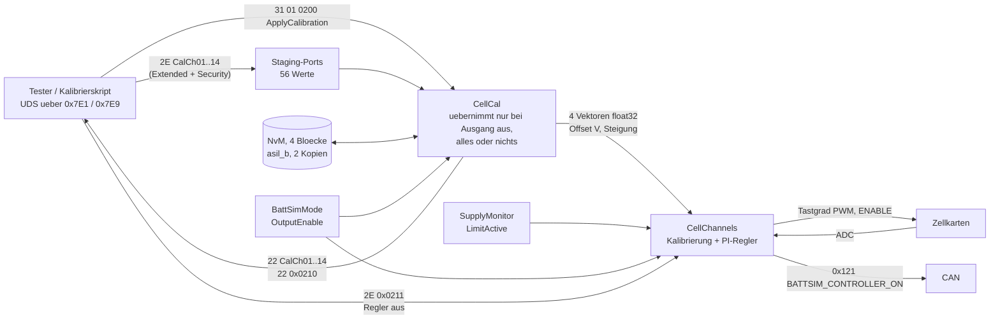

# Stufe C: Kalibrierung, Regler und Diagnose (battsim_master)

Stand: 30.10.2026, Zweig `stufe-c-kalibrierung`, neXtBSW dev `e70ea7b8`. Gilt fuer den **Schreibtischteil** der Stufe C
(Konzept BS-4, FW-06, FW-07, FW-13, FW-14). Nichts davon ist am Geraet gelaufen. Die Safety-Bewertung (Review B-2, FW-17 und die
Punkte C-1 bis C-7) steht im Review-Artefakt "Review BattSim Stufe C" und ist am 30.10.2026 mit a entschieden; die Umsetzung von C-1
(FAIL Grund 5) und C-2 (FAIL Grund 6) und der offene Punkt C-7 stehen in `sicherheitshinweise-stufe-c.md`.

## 1. Datenfluss

## 2. Komponenten

| Komponente | Art | Aufgabe |
|---|---|---|
| `BattSimParams` | Parameter-Komponente (RTE-47/48), kein Code | `CellCount` (Konstante, 14) und `CellVoltLimit_V` (5,0 V), gebunden in `rte.yaml` unter `parameters:` |
| `CellCal` (neu) | Simulink | Kalibrierung von 14 Kanaelen halten, per Anforderung uebernehmen, in den NvM schreiben, an `CellChannels` geben |
| `CellChannels` | Simulink | Sollwert, Kalibrierung, PI-Regler, Tastgrad, Istwert, Status; neu: Kalibrierung, Regler, `LimitActive`, `ControllerOffReq` |
| `BattSimMode`, `SupplyMonitor` | Simulink | unveraendert gegenueber Stufe B; Version 0.3.0 in 0x121 |

Task: alle vier laufen im Task `swc` alle 10 ms, in der Reihenfolge SupplyMonitor, BattSimMode, CellCal, CellChannels.

`tools/gen_swc_ports.py` schreibt die `swc.yaml` und `_data.m` der vier Komponenten, die Verbindungen von `rte.yaml` und die 14
Kalibrierkennungen von `diag.yaml` (zwischen den Markern) aus einer Tabelle. Die Modelle entstehen mit `<Swc>_create.m` und
`swc_build`.

## 3. Kalibrierung je Kanal (FW-06)

Vier Werte je Kanal: Offset und Steigung fuer das **Stellen** und fuer das **Messen**, jeweils `y = Steigung * x + Offset`.

| Wert | Auf dem Draht und im NvM | Bereich | Werkswert |
|---|---|---|---|
| Offset (Stellen, Messen) | `sint16`, 0,1 mV | +-2000 = +-0,2 V | 0 |
| Steigung (Stellen, Messen) | `uint16`, 1e-4 | 9000..11000 = 0,9000..1,1000 | 10000 = 1,0000 |

* **Stellen:** `Befehl = SetSteigung * (Sollwert + Reglerkorrektur) + SetOffset`, die Summe zuerst auf 0..`CellVoltLimit_V` begrenzt, dann
  ueber die Kennlinie `VoltageSetPwm_T` zum Tastgrad. Der Tastgrad ist durch das Tabellenende (5 V nominal, 95,66 %) gedeckelt:
  **die Kalibrierung kann den Tastgrad nie ueber den Wert fuer 5,0 V heben.** Sollwert 0 V bleibt Tastgrad 0 (die Kalibrierung ist
  eine Zwei-Punkt-Kalibrierung bei 1 V und 4 V und beansprucht 0 V nicht).
* **Messen:** `Istwert = MessSteigung * Kennlinienwert + MessOffset`, danach der Tiefpass. Vor dem ersten Lauf von `CellCal` (Port noch 0)
  und bei Werten ausserhalb 0,5..1,5 bzw. +-0,5 V gelten in `CellChannels` die Werkswerte.
* **Ablauf des Testers** (alle Schritte in der Extended-Session, nach `27` mit Stufe "Application"):
  1. Je Kanal `2E 02xx` mit vier Werten (Kennungen `0x0201`..`0x020E`). Das legt die Werte nur bereit; im Betrieb aendert sich nichts.
     Die Diagnose lehnt Werte ausserhalb der Grenzen ab (NRC 0x31).
  2. Ausgang aus, dann `31 01 0200` (`ApplyCalibration`), kurz warten (das Modell laeuft alle 10 ms), `31 03 0200` liest das Ergebnis:
     `0` uebernommen, `1` abgelehnt (Ausgang ein), `2` Wert ausser Bereich (`badChannel` nennt den ersten Kanal, es aendert sich nichts),
     `3` nichts Neues. Neu ist ein Kanal, dessen bereitgelegte Werte sich von den benutzten unterscheiden und nicht alle 0 sind (alle 0 =
     seit dem Start nicht beschrieben). Alles oder nichts.
  3. `22 02xx` liest die **benutzten** Werte zurueck, `22 0210` den Zustand: `0` Werkswerte (nie geschrieben), `1` gespeichert/uebernommen,
     `2` Speicher defekt (Werkswerte oder Werte ersetzt).
* **Ablage:** vier NvM-Bloecke `CalSetOffset`, `CalSetGain`, `CalMeasOffset`, `CalMeasGain` (je 14 Werte, `integrity: asil_b`: zwei Kopien mit
  CRC-32, eine defekte Kopie wird aus der anderen repariert, `write: change`, hoechstens alle 2 s). Sind beide Kopien defekt, laedt der NvM den
  Standard, `CellCal` setzt Werkswerte und Zustand 2, und es entsteht der DTC `NvmDefaultCal<Block>` (`bsw_dtc_range` + `0x06nn`, nn = 0 `CalMeasGain`,
  1 `CalMeasOffset`, 2 `CalSetGain`, 3 `CalSetOffset`). Kein FAIL.

## 4. Regler (FW-07)

PI je Kanal alle 10 ms auf den kalibrierten Istwert (`e = Sollwert - Istwert`, `Kp` 0,2, `Ki` 1,0/s als Startwerte, am Geraet abzustimmen).
Die Korrektur und der Integralanteil sind auf +-`CtrlLimit_V` (0,1 V) geklemmt (Anti-Windup). Er arbeitet nur, wenn

* die Diagnose ihn nicht abgeschaltet hat (`2E 0211`, Element `controllerOff` 1 = aus; nach jedem Start **ein**, nicht gespeichert),
* der Ausgang ein und der Kanal freigegeben ist,
* der Sollwert nicht begrenzt (Status 3) und groesser 0 ist,
* der ADC-Qualifier des Kanals gueltig ist.

Sonst ist die Korrektur 0 und der Integralanteil geloescht. Meldet die Versorgung LIMIT, **steht** der Regler: die Korrektur bleibt, der
Integralanteil bewegt sich nicht. 0x121 `BATTSIM_CONTROLLER_ON` zeigt, ob der Regler nicht abgeschaltet ist.

Nachtrag Geraetebefund (Review C-2c, R-1): Nach einem Sollwertsprung groesser 0,2 V steht der Regler dieses Kanals 500 ms (seit 0.3.2, vorher 300 ms; Parameter `StepThreshold_V`, `StepHold_cycles`), und bei einem
Sollwert unter dem Pegelboden `OutputFloor_V` (0,7 V, ohne Last gemessen) arbeitet er nicht; der Kanalstatus ist dann 4. Dazu `sicherheitshinweise-stufe-c.md` Abschnitt 7.

**Schutzabschaltungen (Review C-1 und C-2)**, unabhaengig vom Regler und von der Diagnose:

* Strommessung (`ISupplyQlf`) 200 ms am Stueck ungueltig: in RUN FAIL, 0x121 `BATTSIM_FAIL_REASON` = 5, Ausgaenge im selben Schritt aus
  (`SupplyMonitor.CurrentInvalid`, Parameter `CurrentInvalid_cycles`). Von STOP nach RUN wird mit ungueltiger Messung direkt FAIL.
* Freigegebener Kanal 100 ms am Stueck mehr als 0,2 V ueber dem Sollwert (Abtastwert, nicht der tiefpassgefilterte Istwert): in RUN FAIL, Grund 6,
  alle Ausgaenge aus (`CellChannels.OverVoltage`, Parameter `OverVoltThd_V`, `OverVoltTime_cycles`), einen 10-ms-Schritt spaeter als Grund 5.

## 5. Diagnose

| Kennung | Inhalt | Lesen | Schreiben |
|---|---|---|---|
| `0x0201`..`0x020E` `CalCh01..14` | je 4 Werte (SetOffset, SetGain, MeasOffset, MeasGain) | Default, Extended | Extended, Security "Application" |
| `0x0210` `CalibrationState` | Zustand 0/1/2 | Default, Extended | nein |
| `0x0211` `ControllerControl` | `controllerOff` 0 ein, 1 aus | Default, Extended | Extended, Security "Application" |
| Routine `0x0200` `ApplyCalibration` | start (Uebernahme), results (Ergebnis, `badChannel`) | | Extended, Security "Application" |

UDS-Adressen unveraendert 0x7E1/0x7E9 (BL-47 ist Sache von neXtBSW).

## 6. NvM und FlexNVM

`project.yaml` beschreibt die Partition und die Bloecke. **Die Partition ist nicht gemacht.** Sie ist nur durch kompletten Chip-Erase
umkehrbar und bekommt wie das Flashen eine eigene Freigabe des Nutzers im Entscheidungsboard, mit Sicherung der Werksfirmware vorher.
Vorschlag fuer diese Freigabe (wie das Eval Board): 4 KB EEPROM, 32 KB D-Flash, 32 KB Backup (`DEPART` 0xB), 20 CSEc-Schluesselplaetze
(der Schluesselraum laesst sich spaeter nicht erweitern; die Zahl ist Teil der Freigabe). Ohne Partition laufen die Bloecke im RAM und
starten mit den Standardwerten: die Kalibrierung geht bei jedem Reset verloren, die Firmware laeuft sonst.

## 7. Pruefstand

* `nextbsw/tools/test --workspace .` (Testliste `ci/tests.yaml`): `battsim-sil` prueft neu die Kalibrierung (Start aus Werkswerten, gespeicherten Werten, ausserhalb liegenden Werten und
  defektem Speicher; Bereitlegen, Uebernehmen, Ablehnen, alles oder nichts, Grenzen inklusive), ihre Wirkung auf Tastgrad und Istwert, den
  Tastgrad-Deckel bei 5,0 V, und den Regler gegen eine Strecke (Verstaerkung 0,99, Offset -0,02 V, 0,25 s Tiefpass, ADC-Teiler):
  Ausregelung auf unter 4 mV, Begrenzung bei +-0,1 V, Stillstand bei LIMIT, keine Korrektur bei ungueltigem ADC, begrenztem Sollwert und Ausgang aus, Abschalten per
  Diagnose. Dazu die Schutzabschaltungen: ungueltige Strommessung (19 Abtastwerte keine Reaktion, ein gueltiger Wert loescht den Zaehler, der 20. fuehrt in
  FAIL Grund 5 mit Ausgaenge-aus im selben Schritt, in STOP kein FAIL, STOP nach RUN mit ungueltiger Messung direkt FAIL) und Ueberspannung (0,15 V
  nie, 0,25 V erst beim 10. Abtastwert, ungueltige Abtastwerte zaehlen nicht und loeschen nicht, grosser Sprung des Sollwerts nach unten ohne Fehlausloesung,
  Sollwert 0 V, nicht freigegebener Kanal und Ausgang aus ohne Reaktion, Grund 6 auf dem Bus).
* Nicht geprueft ohne Geraet: die Regelparameter an der echten Strecke, die Dauer eines NvM-Schreibens, das Verhalten nach einem Reset mit
  partitioniertem FlexNVM, die UDS-Kette bis zur Zellkarte (Security-Schluessel, ISO-TP), und ob der echte Ausgang einem Sprung des Sollwerts
  nach unten schnell genug folgt, damit die Ueberspannungserkennung (C-2) nicht falsch ausloest. Das ist der Geraeteteil.

## 8. Befunde zu neXtBSW (an den Koordinator gemeldet, im Kundenprojekt umgangen oder hingenommen)

1. **Datenidentifier-Elemente und Routinenparameter nur skalar** (`rtegen _diag_scalar`): 56 skalare Required-Ports zum Schreiben und 56
   Provided-Ports zum Zuruecklesen statt Vektorports. Board-Frage `diag-did-vektor`; bis dahin Generatorskript.
2. **Symbolische Dimension und MATLAB-Function-Block:** Embedded Coder bricht mit "does not support symbolic dimensions propagation" ab, wenn ein Vektorport mit
   `dimension: CellCount` direkt in einen MATLAB-Function-Block fuehrt. Umgehung hier: ein Reshape-Block vor und hinter dem Kern (`swc/swc_vec.m`), die
   Konstante ist per `min = max = 14` an die Schleifenlaenge des Modells gebunden. Ein Projekt kann keine andere Zahl binden.
3. **Anfangswert eines Vektor-Provided-Ports:** der "Initial output" des Outports kommt nicht in die ARXML (`DefaultInitValue` 0), also ist der NvM-Standardwert
   eines Blocks immer 0. Gewollt waere 10000 fuer die Steigungen. Hier gleicht `CellCal` das aus (nie geschriebener Block = Werkswerte).
4. **RTE-49 (gleichnamige Ports):** `CellCal` und `CellChannels` hatten beide einen Required-Port `OutputEnable`; die beiden Header definieren dasselbe
   Makro verschieden, der Bau bricht ab. `CellCal.OutputsOn` heisst jetzt anders.
5. **RTE-54** (rtegen-Cast bei Eingangsports mit Konstanten-Dimension und mehreren Lesern, GCC 14) ist hier nicht aufgetreten: jeder Vektor hat genau einen Leser, und
   gebaut wird mit arm-gcc 11.3 (Target) und zig cc (SIL). Mit GCC 14 ist es nicht geprueft.
